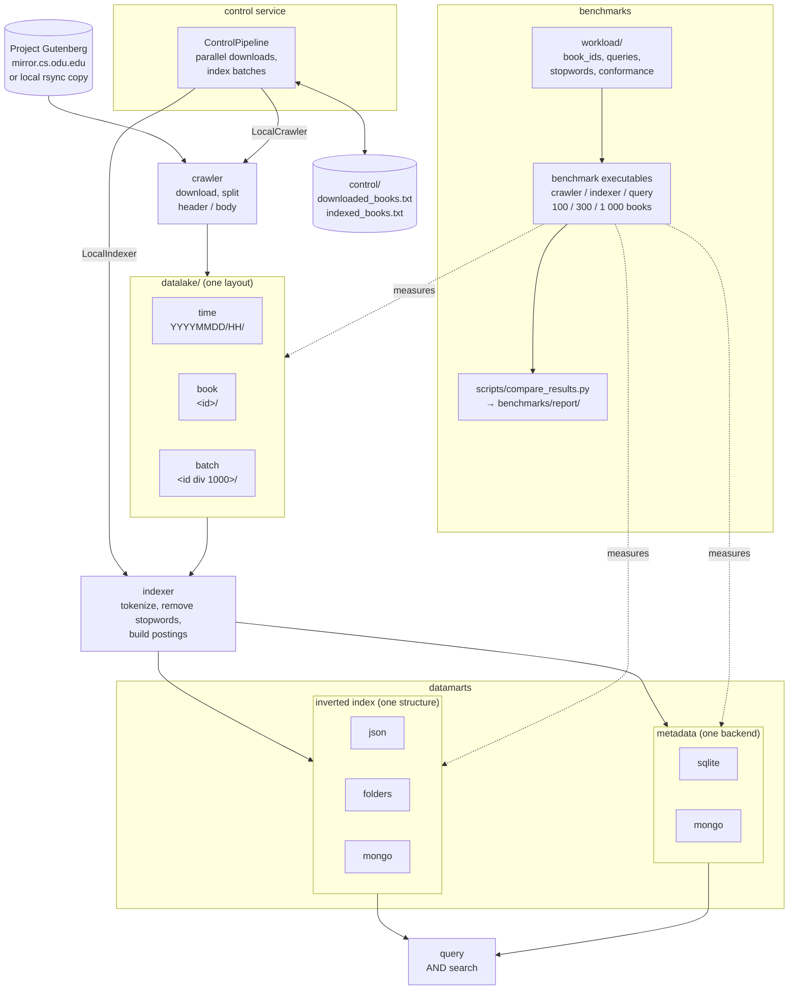

# Query Tarantino — Stage 1: Data Layer (C++)

C++ implementation of the data layer of a search engine over [Project Gutenberg](https://www.gutenberg.org/) books:
a **datalake** with the raw texts, **datamarts** with metadata and an inverted index, and a minimal **control layer**
that coordinates downloading and indexing.

The behavior shared with the Java and Python implementations (split rules, datalake layouts, tokenizer,
datamart formats, control algorithm, benchmark format, command-line interface, code layout and tests) is
defined in [SPEC.md](SPEC.md). The Java implementation is the reference; this one follows the C++ equivalent
that the SPEC gives for each of its choices (SPEC §14) and passes the same conformance cases (SPEC §13).

## Architecture



The control service drives the crawler and indexer in process (it links their libraries); each service can
also be run on its own. The datalake layout, index structure and metadata backend are chosen through
[Configuration](#configuration), and the benchmarks compare the alternatives of each one.

## Data structure comparisons

The project implements several interchangeable structures for each part of the data layer and benchmarks
them against each other with the same books, the same rules and in three languages (Java, Python, C++):

**1. Datalake: how downloaded books are organized** (PDF §3.1)

| Structure | Layout                                            | Trade-off                                                   |
|-----------|---------------------------------------------------|-------------------------------------------------------------|
| `time`    | `datalake/YYYYMMDD/HH/<id>.header.txt`, `.body.txt` | New books are found by date directory; lookup by id scans   |
| `book`    | `datalake/<id>/header.txt`, `body.txt`            | Direct lookup by id; one directory per book                 |
| `batch`   | `datalake/<id div 1000>/<id>.header.txt`, `.body.txt` | Direct lookup by id; few directories with many files        |

Compared on write throughput, lookup time, new books detection, recovery after an interruption and the files
it leaves behind, and number of files, directories and bytes (logical and in whole disk blocks).

**2. Inverted index: how terms map to books** (PDF §4.2)

| Structure | Storage                                           | Trade-off                                                   |
|-----------|---------------------------------------------------|-------------------------------------------------------------|
| `json`    | one `datamarts/inverted_index.json`               | Simple and fast to query; rewritten whole on every update   |
| `folders` | one `datamarts/inverted_index/<c>/<name>.txt` per term (name encoded, SPEC §8.1) | Fine-grained updates; very many small files |
| `mongo`   | MongoDB collection, one document per term         | Indexed random access and concurrency; needs a server       |

Compared on full build time, incremental update time (book by book, as the control layer indexes, and in
batch), index open time, query time (mean, 99th percentile and per kind of query), memory retained while
building and while open, allocated memory, number of terms and disk usage (logical and in whole disk blocks).

**3. Metadata: where title, author, language and path are stored** (PDF §4.1)

| Structure | Storage                                           | Trade-off                                                   |
|-----------|---------------------------------------------------|-------------------------------------------------------------|
| `sqlite`  | `datamarts/metadata.db`, table `books`            | Embedded, no server, SQL queries                            |
| `mongo`   | MongoDB collection `books`                        | Server-based NoSQL, flexible schema                         |

Compared on bulk insertion time, lookup by id and search by author.

Every comparison runs at 100, 300 and 1 000 books to show how each structure scales. See
[Benchmarks](#benchmarks) to run them and generate the comparison report.

## Repository structure

```
services/
  crawler/    downloads books, splits header/body and stores them in the datalake
  indexer/    reads the datalake and builds the inverted index and the metadata datamart
  query/      searches the datamarts
  control/    orchestrates crawler -> indexer and tracks progress in control files
platform/     what every service needs from the operating system, the same on Linux, macOS and Windows:
              UTF-8 paths and files, text, Unicode (ICU), time, SHA-256, threads, the MongoDB driver instance
cmake/        compiler options, and the libraries of SPEC §14 (found on the system or downloaded and built)
scripts/      copied unchanged from the Java repository
  fill_cache.sh        copies the benchmark dataset from Gutenberg's official mirrors (rsync, or HTTP)
  compare_results.py   builds the data structure comparison report from the benchmark results
workload/     experiment definition shared by every language implementation, copied unchanged
  book_ids.txt     candidate book ids for the benchmark dataset, in order
  sample_ids.txt   small sample dataset to test the pipeline quickly
  stopwords.txt    stopwords removed by the tokenizer
  queries.txt      search benchmark workload: 5 queries per category (frequent, rare, mixed, long, empty, non-ASCII)
  conformance/     cases of the SPEC rules, in JSON, that every implementation must pass (SPEC §13)
CMakeLists.txt, CMakePresets.json
```

Each service follows the same layout (SPEC §16), with the class names of Java and the namespace
`tarantino::<service>::<layer>`:

```
services/<service>/
  include/tarantino/<service>/   the headers of the service:
    model/      structs and pure domain logic, grouped by concept (model/book, model/terms)
    ports/      abstract classes the service depends on
    adapters/   implementations of the ports, one directory per functionality:
                  datalake/   time/, book/, batch/   one directory per compared layout
                  index/      json/, folders/, mongo/ one directory per compared structure
                  metadata/   SQLite and MongoDB backends
                  mongo/, stopwords/, gutenberg/
    commands/   use cases
    <Service>Config.hpp, <Service>Factory.hpp
  src/          their sources in the same layout, main.cpp, and the helpers private to one structure
                (e.g. adapters/index/folders/TermFiles)
  tests/        GoogleTest unit tests, in the layout of what they test; conformance/ runs the cases of SPEC §13
    benchmarking/   benchmarks by comparison, and support/ code shared with the benchmarks of the other services
```

The following directories are **created at runtime** in the project root and are not versioned:

| Directory     | Written by | Content                                                              |
|---------------|------------|----------------------------------------------------------------------|
| `datalake/`   | crawler    | `<id>.header.txt` / `<id>.body.txt` in the selected layout           |
| `datamarts/`  | indexer    | `inverted_index.json`, `inverted_index/`, `metadata.db`              |
| `control/`    | control    | `downloaded_books.txt`, `indexed_books.txt`                          |
| `benchmarks/` | benchmarks | `cache/` dataset, `results/` CSVs, `report/` comparison, raw results per pass, `tmp.noindex/` scratch files |
| `build/`      | CMake      | one directory per preset, with the executables in `bin/`           |

## Requirements

It builds and runs on **Linux, macOS and Windows** (64-bit):

- A C++20 compiler. It is checked with GCC 15 on Linux, GCC 16 (MinGW-w64) on Windows and Clang 21 with
  libc++; the [CI workflow](.github/workflows/ci.yml) also builds it with Apple Clang and Visual Studio 2022.
- CMake 3.21 or later. Ninja is optional.
- **ICU**, for lowercasing and letters as Java does (SPEC §7). Windows 10 (version 1903) and later already
  have it; elsewhere install it as shown below.
- **libcurl**, for downloads (SPEC §4). macOS has it; on Windows it is downloaded and built with Schannel.
- SQLite, nlohmann/json and GoogleTest: the ones installed are used, and otherwise CMake downloads and
  builds them inside the build directory, each checked against its SHA-256. SQLite is always 3.53.4, the
  version Java's `sqlite-jdbc` bundles (SPEC §11), unless you configure with `-DTARANTINO_SQLITE=SYSTEM`.
- The **MongoDB C++ driver** (mongocxx), optionally, for the `mongo` index and metadata. The
  `release-mongo` preset downloads and builds it (r4.6.0); an installed one is used when found. A build
  without it rejects `mongo` as a configuration error (SPEC §2) and skips the MongoDB tests.
- MongoDB 7.0, only for the `mongo` index or metadata backends and their tests.
- Python 3.10+ for the comparison report (matplotlib is optional and only adds charts), and Bash for
  `scripts/fill_cache.sh` (Git Bash or WSL on Windows).

| System          | Install                                                                              |
|-----------------|--------------------------------------------------------------------------------------|
| Ubuntu, Debian  | `sudo apt install build-essential cmake ninja-build libicu-dev libcurl4-openssl-dev` (and `libssl-dev` for MongoDB) |
| Fedora          | `sudo dnf install gcc-c++ cmake ninja-build libicu-devel libcurl-devel` (and `openssl-devel` for MongoDB) |
| macOS           | `xcode-select --install`, then `brew install cmake ninja icu4c`                      |
| Windows         | Visual Studio 2022 with *Desktop development with C++* (it includes CMake and Ninja), or MinGW-w64 GCC (WinLibs, MSYS2 UCRT64) with CMake and Ninja; and Git for Windows |

MongoDB 7.0 is the version shared by every implementation. For the benchmarks it must run on the machine
itself, not inside a virtual machine, with its cache fixed at 1 GB (SPEC §11); by default MongoDB takes up to
half of the RAM minus 1 GB.

**Linux.** Either install the official MongoDB 7.0 Community packages for your distribution
(https://www.mongodb.com/docs/v7.0/administration/install-on-linux/), set the cache in `/etc/mongod.conf`
and start it with `sudo systemctl start mongod`, or run the official image with host networking, which on
Linux is as fast as a native install because containers share the host kernel:

```bash
docker run -d --name tarantino-mongo --network host mongo:7.0 --wiredTigerCacheSizeGB 1
```

Without root, the official archive works as well: unpack
`https://fastdl.mongodb.org/linux/mongodb-linux-x86_64-ubuntu2204-7.0.<patch>.tgz` anywhere and run
`bin/mongod --dbpath <dir> --wiredTigerCacheSizeGB 1`.

**macOS.** Docker runs containers inside a virtual machine there, which reserves its own memory and adds a
network round trip to every operation, so install MongoDB natively:

```bash
brew tap mongodb/brew && brew install mongodb-community@7.0
brew services start mongodb-community@7.0   # stop with: brew services stop mongodb-community@7.0
```

**Windows.** Install MongoDB 7.0 Community Server with its MSI installer, which runs it as a service.

The cache setting, in `/etc/mongod.conf` on Linux, `/opt/homebrew/etc/mongod.conf` on macOS or `mongod.cfg`
in the installation directory on Windows, goes inside the existing `storage:` section:

```yaml
storage:
  wiredTiger:
    engineConfig:
      cacheSizeGB: 1
```

For development on any system, `docker compose up -d` starts the same version (`docker compose down` stops
it, `-v` also deletes the data).

## Building

From the project root:

```bash
cmake --preset release             # configure in build/release
cmake --build --preset release     # build
ctest --preset release             # run the tests
```

The executables are in `build/release/bin/`: `crawler`, `indexer`, `query` and `control`, and the tests and
benchmarks of each service. For MongoDB support use the `release-mongo` preset instead, which builds the
driver the first time (a few minutes) and puts everything in `build/release-mongo/bin/`.

- **Windows with Visual Studio:** run the commands in a *Developer PowerShell for VS 2022*.
- **Windows with MinGW-w64:** add the generator to the first command, `cmake --preset release -G Ninja`.
- The same build without presets: `cmake -S . -B build -DCMAKE_BUILD_TYPE=Release`, then
  `cmake --build build --parallel`.

Rebuild after changing the code of any service; the control service links the crawler and indexer libraries.

## Configuration

Every setting has a default that works when running from the project root. Override them with environment variables:

| Variable                    | Default                     | Values                   |
|-----------------------------|-----------------------------|--------------------------|
| `TARANTINO_DATALAKE`        | `datalake`                  | path                     |
| `TARANTINO_DATAMARTS`       | `datamarts`                 | path                     |
| `TARANTINO_CONTROL`         | `control`                   | path                     |
| `TARANTINO_BENCHMARKS`      | `benchmarks`                | path                     |
| `TARANTINO_WORKLOAD`        | `workload`                  | path                     |
| `TARANTINO_DATALAKE_LAYOUT` | `time`                      | `time`, `book`, `batch`  |
| `TARANTINO_INDEX`           | `json`                      | `json`, `mongo`, `folders` |
| `TARANTINO_METADATA`        | `sqlite`                    | `sqlite`, `mongo`        |
| `TARANTINO_MONGO_URI`       | `mongodb://localhost:27017` | connection string        |
| `TARANTINO_PARALLEL_DOWNLOADS` | `8`                      | books the control service downloads at once (1 = one at a time) |
| `TARANTINO_INDEX_BATCH`     | `100`                       | books indexed per index flush by the control service (1 = book by book) |
| `TARANTINO_MIRROR`          | (none)                      | local copy of Gutenberg's generated collection to read books from instead of downloading them; without a workload file, the control service takes all its books |

The crawler and the indexer must use the same `TARANTINO_DATALAKE_LAYOUT`; the indexer and the query service must use
the same `TARANTINO_INDEX` and `TARANTINO_METADATA`. Paths and arguments are UTF-8 on every system, also on
Windows, where the console is switched to UTF-8 while a service runs.

## Running

Every service is an executable run from a terminal, from the **project root**, so `datalake/`, `datamarts/`
and `control/` are created there (SPEC §15). Books are downloaded from the official Project Gutenberg mirror
`mirror.cs.odu.edu`, one request per book, and never from `www.gutenberg.org`, whose robot policy forbids
automated access: redirects are followed only within the mirror. When the mirror answers that it is busy
(HTTP 429 or 503), every download waits as long as it asks, or 1, 2, 4, 8 and 16 seconds, and retries up to 5
times (SPEC §4). For many books, copy them first in bulk with rsync, Project Gutenberg's documented way to
mirror its collection, and point `TARANTINO_MIRROR` at the copy; the crawler then reads them from disk:

```bash
rsync -av --include='*/' --include='pg[0-9]*.txt' --exclude='*' rsync.ibiblio.org::gutenberg-epub/ ~/gutenberg-txt/
export TARANTINO_MIRROR=~/gutenberg-txt
```

Copying every plain text takes some tens of gigabytes. Networks that block the rsync port (873), as some
university networks do, need another connection.

**Run the whole pipeline** with the control service. It downloads and indexes every book of a workload file,
or, without one, every book of `TARANTINO_MIRROR` when it is set and those of `workload/sample_ids.txt`
otherwise. It can be interrupted and run again at any time. It downloads `TARANTINO_PARALLEL_DOWNLOADS` books
at once (8 by default) and records each one in `control/` as soon as it is stored. It indexes in batches of
`TARANTINO_INDEX_BATCH` books (100 by default), with one index write per batch while the next downloads go on,
so a downloaded book becomes searchable when its batch is written; an interrupted batch is indexed again on
the next run:

```bash
build/release/bin/control                  # the sample, or every book of the mirror
build/release/bin/control book_ids.txt     # the books of workload/book_ids.txt
```

**Or run each service by hand**, in pipeline order:

```bash
build/release/bin/crawler 1342 84            # download and store books 1342 and 84
build/release/bin/indexer 1342 84            # index them, one index write for both
build/release/bin/query adventure island     # search
```

Run by hand, the crawler and indexer do not update `control/`; only the control service does.

**Choose the structures** with the variables of [Configuration](#configuration), for example:

```bash
docker compose up -d
export TARANTINO_DATALAKE_LAYOUT=batch TARANTINO_INDEX=mongo TARANTINO_METADATA=mongo
build/release-mongo/bin/control
```

In PowerShell on Windows the executables are `build\release\bin\control.exe` and so on, and variables are
set with `$env:TARANTINO_INDEX = "folders"`.

## Tests

```bash
ctest --preset release                                # C++ services
python3 -m unittest discover -s scripts -t scripts    # comparison report
```

The tests also run the conformance cases of `workload/conformance/` (SPEC §13): the header and body split,
datalake paths (where the crawler writes each book and where the indexer reads it), header fields, tokenizer,
`folders` file names, query terms and search, each case reported by name. A test executable such as
`build/release/bin/indexer_tests` can also be run by itself; it finds `workload/` from the working directory or
from the sources it was built from, or at `TARANTINO_WORKLOAD`.

`EndToEndTest`, in the control service, runs the whole pipeline over a local mirror of three small books: given
no workload file, the control service takes every book of the mirror into the datalake, three downloads at
once, and indexes them in batches of two, and a search finds each book with its title and author. It runs once
for each datalake layout and each index structure.

The tests of the MongoDB adapters, and the end-to-end run on MongoDB, use the server at `TARANTINO_MONGO_URI`
(`localhost:27017` by default) when it answers, in a temporary database of their own that is dropped after each
test. Otherwise, and in a build without MongoDB support, they are skipped, not failed: C++ has no
Testcontainers to start one (SPEC §17).

## Benchmarks

[BENCHMARKS.md](BENCHMARKS.md) explains step by step how to fill the dataset, run the benchmarks and build the
comparison report. In short, from the project root, with MongoDB 7.0 set up as in [Requirements](#requirements):

```bash
scripts/fill_cache.sh                                                  # dataset, once
cmake --preset release-mongo && cmake --build --preset release-mongo  # build
build/release-mongo/bin/crawler_benchmarks                             # run (each writes benchmarks/results/cpp-<service>.csv)
build/release-mongo/bin/indexer_benchmarks
build/release-mongo/bin/query_benchmarks
python3 scripts/compare_results.py                                     # report: benchmarks/report/comparison.md
```

## Differences from the Java implementation

The behavior is the one of the SPEC, checked on the same books: on 119 Gutenberg books, the datalake, the
`json` and `folders` indexes, the metadata and the results of every query of `workload/queries.txt` are
identical to those of the Java implementation. Beyond that:

- **Windows.** The services and tests run on Windows as on Unix: files are reached through `\\?\` paths, so
  neither the 260-character limit nor the reserved device names, which are also terms of the `folders` index
  (`con`, `aux`, `nul`, SPEC §12), get in the way, and arguments and output are UTF-8 (the Java services read
  non-ANSI arguments such as `ΣΑΣ` as `???` there).
- **Benchmark harness.** C++ has no JMH: each benchmark executable runs its own harness with the same scheme
  (SPEC §11): one process per benchmark, structure, size and pass, warm-up and measured iterations, and the
  same results files.

## Future improvements

**Ranked search (Stage 2).** The inverted index stores only which books contain each term: the tokenizer
counts term frequencies, but every structure discards them when it stores postings (SPEC §8.1). That is
enough for boolean search, the AND queries this stage benchmarks, but not for ordering results by relevance
(TF-IDF, BM25) as a real search engine does. Ranking would need term frequencies in the postings of the three
structures, the length of each book in the metadata, and results ordered by score; it changes the SPEC for
every language and every benchmark result, so it belongs to Stage 2, before its benchmarks are run.
